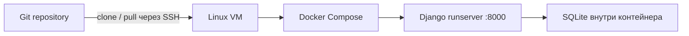

# Django Deployment Lab


Учебный deployment-проект: упаковка Django-приложения в Docker и запуск через Docker Compose. Репозиторий демонстрирует управление зависимостями Poetry, настройку через окружение и подготовку переноса приложения на Linux VM через SSH.

**Статус:** конфигурация учебного запуска подготовлена. Доступность публичной VM и production deployment не подтверждены. Исходное приложение содержит магазин, блог, авторизацию и Django REST Framework; фокус этого репозитория — упаковка и запуск.

## Стек и архитектура

Python 3.11, Django 4.2, Django REST Framework, SQLite, Poetry 2.5.1, Docker и Docker Compose. Версии зависимостей зафиксированы в `poetry.lock`; контейнер устанавливает только основную группу без отдельного Python virtualenv (`POETRY_VIRTUALENVS_CREATE=false`).



Схема показывает предполагаемый путь переноса. Для локального запуска VM и SSH не требуются. Compose содержит один сервис `web`, политику `restart: always` и публикацию порта 8000. При запуске последовательно выполняются `migrate`, `collectstatic --noinput` и `runserver`.

## Быстрый запуск

Нужны Git, Docker Engine / Docker Desktop с Linux containers и Docker Compose v2.

```sh
git clone https://github.com/Sarmagon/skillbox-django-deploy.git
cd skillbox-django-deploy
cp .env.example .env
```

В PowerShell вместо последней команды: `Copy-Item .env.example .env`.
Замените `DJANGO_SECRET_KEY=change-me` длинным случайным ключом. `.env` игнорируется Git.

| Переменная | Пример | Назначение |
| --- | --- | --- |
| `DJANGO_DEBUG` | `1` | Учебная отдача статики и debug toolbar |
| `DJANGO_SECRET_KEY` | собственный случайный ключ | Подпись Django; placeholder не использовать |
| `DJANGO_ALLOWED_HOSTS` | `127.0.0.1,localhost` | Адреса без схемы/порта, через запятую |

```sh
docker compose up -d --build
docker compose ps
docker compose logs --tail 100 web
docker compose exec web python manage.py createsuperuser
```

Приложение: http://localhost:8000/; административная панель: http://localhost:8000/admin/.

```sh
docker compose exec web python manage.py check
docker compose exec web python manage.py test
docker compose down
```

Последняя команда останавливает и удаляет контейнер. **SQLite не вынесена в постоянный том: удаление или пересоздание контейнера может потерять базу.** Не храните здесь нужные данные без отдельной резервной копии. Пользовательские загрузки также не вынесены в постоянное хранилище. Наличие тестовых модулей не означает успешный CI: workflow для этого репозитория не настроен.

## Перенос на VM

Установите Docker и Compose на своей Linux VM, подключитесь `ssh user@host`, клонируйте репозиторий, создайте `.env` и выполните команды запуска. Для проверки через SSH-туннель оставьте allowed hosts локальными: `ssh -L 8000:127.0.0.1:8000 user@host`, затем откройте localhost:8000. Не публикуйте debug-приложение в интернете; ограничьте порт сетевыми правилами VM. Конкретный провайдер и работающий публичный адрес здесь не заявляются.

## Безопасность и граница учебного проекта

- `runserver` — сервер разработки; `DEBUG=1` нужен по исходному заданию для статики, но раскрывает диагностические данные. В исходной формулировке это называлось production; такая конфигурация не является production-ready.
- Порт `8000:8000` опубликован на всех интерфейсах хоста; доступ необходимо ограничить. Секрет в settings имеет небезопасный development fallback: задавайте собственный ключ.
- В проекте присутствует debug toolbar. TLS, reverse proxy, rate limiting, постоянное хранилище, мониторинг и healthcheck не настроены.
- Зависимости сохранены по учебной работе; аудит и обновление безопасности перед внешним размещением обязательны. Новые версии в рамках оформления не подменялись.

Для production потребуются WSGI/ASGI-сервер (например, Gunicorn), `DEBUG=0`, корректная отдача static/media отдельным сервером, TLS, закрытые credentials, резервные копии и проверка `manage.py check --deploy`. Это дальнейшие работы, а не реализованные возможности. Одного переключения DEBUG недостаточно.

## Структура

- `mysite/` — Django-приложение, шаблоны и миграции.
- `Dockerfile` — установка зависимостей Poetry и сбор образа.
- `docker-compose.yml` — учебный запуск, миграции и restart policy.
- `.env.example` — только образцы настроек; `.gitignore` — исключения окружения, БД и кэшей.

## Учебная задача

Проект выполнен на основе практической работы 20 Skillbox: Poetry/Pipenv, Docker без вложенного virtualenv, SSH, размещение кода и запуск на VM с `restart: always`. Требование `DJANGO_DEBUG=1` сохранено в учебном сценарии. Репозиторий подтверждает наличие конфигурации; сам факт выполнения задания не доказывает актуальную доступность VM.

При аудите 11.10.2026 Docker-образ собран, `manage.py check` прошёл и 10 существующих Django-тестов прошли в одноразовой SQLite. Это не подтверждает production deployment или доступность VM.
